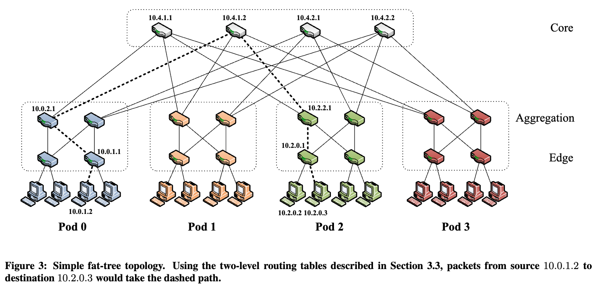
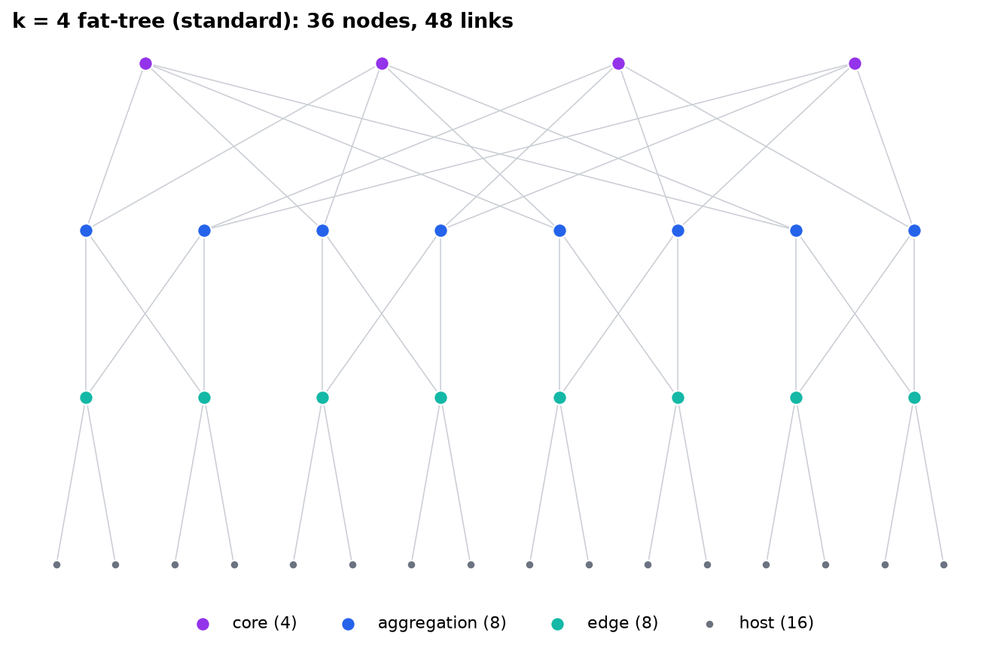
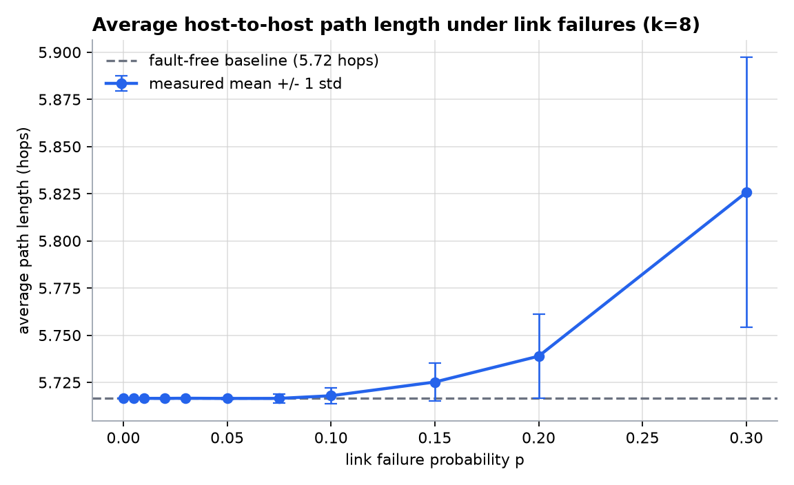
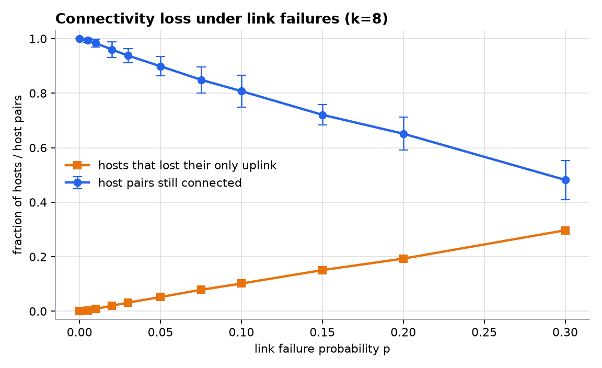
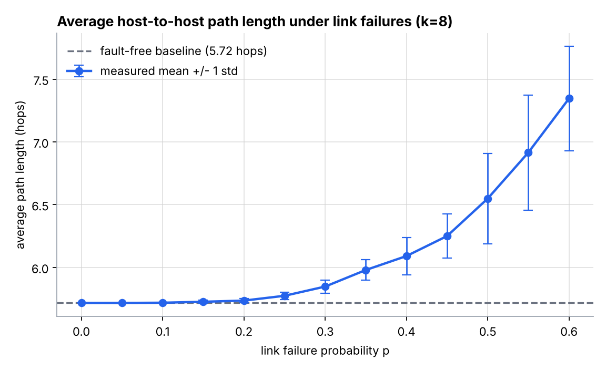
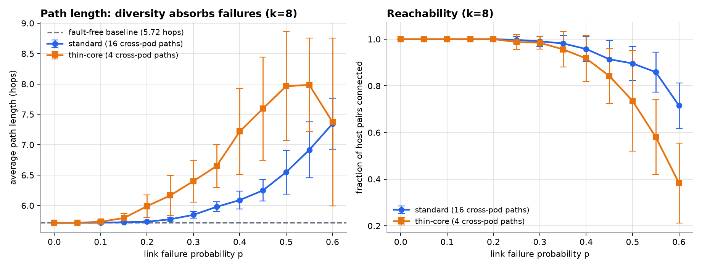
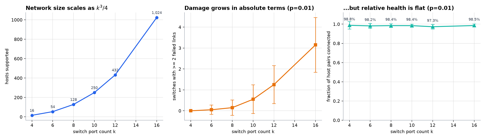

# Fat-Tree Topology Generation and Analysis

Homework 1 — *Communication Networks for Data Centers and Artificial Intelligence* (361.2.2460), Semester A, 2026.
Author: **Yarin Oziel**.

A generator for the k-ary fat-tree of Al-Fares, Loukissas and Vahdat [1], a link failure
model, and a quantitative study of **how the average host-to-host path length degrades as
links fail**.



---

## 1. What is here

```
fattree/
  topology.py    builds the graph from the single parameter k
  failures.py    removes links (or whole switches) according to a failure model
  metrics.py     measures path length, reachability, path diversity
  experiment.py  sweeps an input parameter (or compares variants) into rows of results
  plots.py       turns those rows into figures
  validate.py    structural self-checks of the generated topology
main.py          command line interface
tests/           unit tests (12 of them, runnable without pytest)
config.example.json
results/         CSVs and PNGs produced by the runs below
```

Every module is commented with *why*, not just *what*, and each one ends with a
`WHERE TO EDIT` block pointing at the knobs that are meant to be turned.

## 2. Running it

```bash
# if venv required ------
python3 -m venv venv

source venv/bin/activate
# ------------------------

pip3 install -r requirements.txt          # networkx + matplotlib

python3 main.py validate   --k 8          # structural self-checks
python3 main.py validate   --k 8 --variant thin-core   # ...on the control topology too
python3 main.py build      --k 4          # print the topology, draw it
python3 main.py experiment --k 8          # the main sweep -> CSV + figures 1 and 2
python3 main.py compare    --k 8          # controlled experiment -> figure 4
python3 main.py scale                     # sweep k -> figure 3
python3 main.py all        --k 8          # everything, into results/
python3 tests/test_fattree.py             # unit tests
```

Everything written below was produced by:

```bash
python3 main.py all --k 8
python3 main.py experiment --k 8 --failure-scope fabric \
       --rates linspace:0,0.6,13 --trials 20 --outdir results/fabric
```

## 3. Topology design

One parameter, `k`, the port count of every switch — all switches are identical commodity
switches, which is the central claim of [1]. Everything else follows:

| | count | why |
|---|---|---|
| pods | k | by definition |
| edge switches | k²/2 | k/2 per pod x k pods; k/2 ports down to hosts, k/2 up|
| aggregation switches | k²/2 | k/2 per pod x k pods, complete bipartite with the edge layer |
| core switches | (k/2)² | k/2 groups of k/2; each has one port per pod |
| hosts | k³/4 | k/2 per edge switch |
| links | 3k³/4 | k³/4 in each of the three layers |

The wiring rule that matters is in `topology._wire_core_layer`: **aggregation switch `a` of
every pod connects to all k/2 core switches of core group `a`.** That single rule is what
produces (k/2)² equal-cost paths between any two hosts in different pods, and it is the
reason the failure results below look the way they do. The generator also assigns the
paper's IP addresses (`10.pod.switch.ID`, core at `10.k.j.i`) as node attributes so the
output can be checked against the figures in [1].

The generator also builds a second, deliberately crippled **`thin-core`** variant, used as
a control in §5. It keeps exactly one uplink per aggregation switch, so the core shrinks
from (k/2)² switches to k/2 and the cross-pod path count drops from 16 to 4 at k = 8.
Hosts, pods, edge switches and the entire edge↔aggregation layer are identical. It is not
a strawman: it is a 4:1 oversubscribed network, which is what most real data centers
actually build. Both variants come out of the same `_wire_core_layer` function, differing
only in `FatTreeSpec.uplinks_per_agg`.

**Verification.** `python3 main.py validate --k 8` runs 19 structural assertions — exact node
and link counts, every switch using exactly k ports, strict layering (no link ever skips or
stays inside a tier), each core switch touching every pod exactly once, connectivity, the
2/4/6-hop distance pattern matching a closed form computed independently, the measured
cross-pod path count matching (k/2)², and a bisection cut of exactly k³/8 links (full
bisection bandwidth). Every expected value comes from `FatTreeSpec`, so the same checks run
unchanged against the thin-core control and assert *its* correct numbers — a control
topology that silently skipped validation would be worthless as a comparison. All pass for
k = 2, 4, 6, 8 in both variants.

## 4. Input specification

| Parameter | CLI flag | Default | Meaning |
|---|---|---|---|
| Switch port count | `--k` | 8 | the only structural parameter; must be even |
| Link failure rate | `--failure-rate` | 0.0 | fraction/probability of links that fail |
| Sweep points | `--rates` | 11 points, 0→0.3 | `0,0.05,0.1` or `linspace:0,0.6,13` |
| k values to sweep | `--ks` | 4,6,8,10,12,16 | for the scale experiment |
| Repetitions | `--trials` | 20 | independent failure patterns per point |
| Master seed | `--seed` | 1234 | the entire run is reproducible from this |
| Failure mode | `--failure-mode` | `bernoulli` | `bernoulli` (per-link coin flip) or `exact` (fixed count) |
| Failure scope | `--failure-scope` | `all` | `all`, `fabric`, `agg-core`, `edge-agg` |
| Host-pair filter | `--pair-filter` | `all` | `all`, `cross-pod`, `intra-pod` |
| Topology variant | `--variant` | `standard` | `standard` (the fat-tree of [1]) or `thin-core` (the control, §5 experiment C) |
| Sampling | `--sample-sources` | all hosts | measure from N source hosts instead of all |
| Output directory | `--outdir` | `results` | CSVs and PNGs |

All of them can also be supplied in a JSON config file (`--config config.json`, see
`config.example.json`). Precedence is **defaults < config file < command line flags**.

Reproducibility: each (rate, trial) pair gets its own deterministic sub-seed derived from
the master seed, so any single data point can be regenerated in isolation, and the seed is
stored in every CSV row.

## 5. Metric analysis

### The question

> A fat-tree is advertised as fault tolerant because of its path diversity. **At what
> failure rate does that actually stop being true, and what breaks first — the length of
> the paths, or the existence of paths at all?**

### The metric

Average shortest path length in hops between host pairs, measured by BFS from every host
(or a sample, for large k), averaged over the pairs that are *still connected*. Reported
together with two companions, because the average alone is misleading:

* **reachability** — the fraction of host pairs that still have any path,
* **isolated hosts** — the fraction of hosts that lost their single uplink.

A fault-free fat-tree has a trivial distance distribution: 2 hops within a rack, 4 hops
within a pod, 6 hops across pods. For k = 8 the analytical mean is **5.7165 hops**, and the
measured value at p = 0 matches it to 9 decimal places — a useful end-to-end check that the
generator and the measurement agree.

### Experiment A — failures anywhere in the network (`--failure-scope all`)

`python3 main.py experiment --k 8` — k = 8 (128 hosts, 80 switches, 384 links), 11 failure
rates, 20 independent trials each, all 16 256 ordered host pairs measured per trial.




| p | avg path length | reachability | isolated hosts |
|---|---|---|---|
| 0.00 | 5.717 | 100.00 % | 0.0 % |
| 0.01 | 5.717 | 98.37 % | 0.8 % |
| 0.05 | 5.717 ± 0.001 | 89.88 % | 5.2 % |
| 0.10 | 5.718 ± 0.004 | 80.75 % | 10.2 % |
| 0.20 | 5.739 ± 0.022 | 65.14 % | 19.3 % |
| 0.30 | 5.826 ± 0.071 | 48.18 % | 29.7 % |

**Discussion.** The path length curve is almost perfectly flat: at a 10 % link failure rate
the average surviving path is 5.718 hops against a fault-free 5.7165 — a stretch of 0.03 %.
Meanwhile a fifth of the host pairs can no longer talk at all. The two curves tell one
story: **in a fat-tree, failures do not make paths longer, they make paths disappear.**

The reason is structural. A cross-pod pair has (k/2)² = 16 equal-cost 6-hop paths, so losing
one fabric link almost never costs a hop — an alternative 6-hop route is still there. But
every host hangs off its edge switch by a *single* link, with no redundancy at all. The
isolated-host curve is therefore exactly linear in p (at p = 0.10, 10.2 % of hosts are cut
off; at p = 0.30, 29.7 %), and since a pair needs both endpoints alive, reachability tracks
roughly (1−p)² plus the smaller contribution of fabric partitions. The fat-tree's redundancy
is entirely in the fabric and entirely absent at the host edge, which is why real data
centers dual-home servers to two ToR switches.

A second, subtler point: the average is computed over *surviving* pairs, so it is a biased
estimator under heavy damage — the long cross-pod pairs are the first to be cut, which drags
the mean *down* and partly masks the stretch of the pairs that remain. This is exactly why
the reachability curve has to be published next to it. Reporting the path length alone would
have made a collapsing network look healthy.

### Experiment B — failures restricted to the fabric (`--failure-scope fabric`)

To see the stretch effect on its own, the same experiment with the host uplinks protected,
over a much wider range of p:

`python3 main.py experiment --k 8 --failure-scope fabric --rates linspace:0,0.6,13 --trials 20 --outdir results/fabric`



| p | avg path length | reachability | isolated hosts |
|---|---|---|---|
| 0.10 | 5.719 ± 0.003 | 100.00 % | 0 % |
| 0.20 | 5.735 ± 0.016 | 100.00 % | 0 % |
| 0.30 | 5.847 ± 0.053 | 99.09 % | 0 % |
| 0.40 | 6.091 ± 0.148 | 95.79 % | 0 % |
| 0.50 | 6.549 ± 0.362 | 89.61 % | 0 % |
| 0.60 | 7.346 ± 0.418 | 71.55 % | 0 % |

**Discussion.** With the single points of failure removed the fabric is remarkably tough:
up to about **p ≈ 0.25 it absorbs failures with no measurable cost at all** (< 1 % stretch,
100 % reachability), because the 16 parallel cross-pod paths mean the probability that *all*
of them are broken is negligible. Past that the curve turns sharply upward and the error
bars widen fast — at p = 0.5 the standard deviation across trials is 0.36 hops, five times
the mean shift seen in experiment A. That growing variance is itself a finding: beyond the
knee, the network's behaviour stops being a property of the failure *rate* and becomes a
property of the particular failure *pattern*, so a single simulation run would no longer be
a trustworthy answer. Paths stretch past 6 hops only when a packet has to go *down* and back
*up* through a different aggregation switch, which a shortest-path router can only do once
the direct up-across-down route is fully gone.

Comparing A and B isolates the two failure mechanisms cleanly: experiment A's degradation is
dominated by the un-redundant host links, experiment B's by the exhaustion of fabric path
diversity, and the fabric's threshold sits an order of magnitude higher in p.

### Experiment C — isolating path diversity (the control)

Experiments A and B show *that* the fat-tree absorbs failures. They do not prove *why*.
The explanation offered — 16 equal-cost cross-pod paths — is a hypothesis, and the way to
test it is to build a network that differs in that one property and nothing else.

That is the `thin-core` variant: same k, same 128 hosts, same 8 pods, same 32 edge and 32
aggregation switches, same complete-bipartite edge↔aggregation layer, same per-link failure
probability. The only change is one uplink per aggregation switch instead of four, which
drops cross-pod path diversity from 16 to 4 (and the core from 16 switches to 4). Host
uplinks are held constant with `--failure-scope fabric`, because they are identical in both
variants and would otherwise add the same large effect to both curves and bury the variable
under test.

`python3 main.py compare --k 8` — k = 8, 13 failure rates, 20 trials each, both variants.



| p | path length, standard | path length, thin-core | reachability, standard | reachability, thin-core |
|---|---|---|---|---|
| 0.10 | 5.719 | 5.735 | 100.0 % | 100.0 % |
| 0.20 | 5.735 | 5.990 | 100.0 % | 100.0 % |
| 0.30 | 5.847 | 6.402 | 99.1 % | 98.5 % |
| 0.40 | 6.091 | 7.219 | 95.8 % | 91.8 % |
| 0.50 | 6.549 | 7.964 | 89.6 % | 73.6 % |
| 0.60 | 7.346 | 7.374 | 71.5 % | 38.3 % |

**Discussion.** The curves separate exactly as the hypothesis predicts, and the separation
is large. The standard tree stays flat until p ≈ 0.25; the thin core starts stretching at
p ≈ 0.10, less than half the failure rate. At p = 0.5 the thin core has lost 2.25 hops and a
quarter of its host pairs, against 0.83 hops and a tenth for the standard tree. Since path
diversity is the only structural difference between the two networks, the gap is
attributable to it and to nothing else — which turns the explanation in experiments A and B
from a plausible story into a measured result.

Two things are worth saying out loud when reading this figure.

**The confound runs the wrong way.** The thin core has fewer links in the top layer (32
instead of 128), so at any given p it suffers fewer failures *in absolute terms* — roughly
160 eligible links against 256. The crippled topology is handed an advantage and still
degrades faster, so the confound weakens the measured gap rather than manufacturing it.
The real effect is larger than the figure shows.

**The thin-core path length curve bends back down at p ≥ 0.55** (7.985 → 7.374 hops) while
its reachability falls off a cliff (58 % → 38 %). That is not noise, and it is not the
network improving. It is the selection effect predicted in experiment A, now visible in the
data: the average is taken over *surviving* pairs, the longest cross-pod pairs die first,
and their removal pulls the mean down. The moment a path length curve starts improving
under more damage is the moment it has stopped being a measure of performance — which is
precisely why reachability is plotted beside it rather than in a separate section.

The practical reading: a 4:1 oversubscribed network costs a quarter of the top-layer links
and a quarter of the core switches, and in exchange its failure tolerance does not degrade
by a factor of four but loses its flat region almost entirely. Redundancy in a fat-tree is
not a linear purchase.

### Experiment D — scale (`python3 main.py scale`)

k from 4 to 16 at a fixed 1 % link failure rate, 20 trials each, 32 sampled source hosts per
trial. Three panels, three different units, so three separate axes.



| k | hosts | switches with ≥ 2 failed links | reachability |
|---|---|---|---|
| 4 | 16 | 0.00 | 98.75 % ± 3.8 |
| 6 | 54 | 0.05 | 98.17 % ± 2.6 |
| 8 | 128 | 0.15 | 98.44 % ± 1.9 |
| 10 | 250 | 0.55 | 98.42 % ± 1.5 |
| 12 | 432 | 1.25 | 97.30 % ± 2.4 |
| 16 | 1024 | 3.15 | 98.52 % ± 1.5 |

**Discussion.** The left panel is the "basic" metric from the assignment sheet (k³/4 hosts,
16 → 1024) and the middle one is the "intermediate" metric (switches losing two or more
links, 0.0 → 3.2). The third panel exists to stop the middle one being misread.

The tempting conclusion from the middle panel is *bigger networks are more fragile*. That
is wrong, and it is worth being precise about why, because the growth has two separate and
entirely arithmetic causes. First, there are more switches: 20 at k = 4 against 320 at
k = 16. Second, each switch is larger, and a switch with more ports has more ways to lose
two of them — at p = 0.01 the per-switch probability of a double failure rises from 0.06 %
at k = 4 to 1.09 % at k = 16. Multiply the two and you get the observed 0.01 → 3.5. Neither
factor is a weakness in the design; both are what scaling k *means*.

The right panel measures the thing that actually matters — the fraction of host pairs that
can still communicate — and it is flat at roughly 98 % across a 64-fold increase in network
size. **Damage grows in proportion to the network; functional health does not degrade at
all.** That is the fat-tree scaling well, and it is only visible because the two quantities
are plotted side by side instead of one of them being reported alone.

The real lesson is about rarity rather than fragility. At k = 4 a switch losing two links is
a freak event you would essentially never observe; at k = 16 there are about three at any
moment; at k = 48 — the 27,648-host configuration discussed in [1] — it is continuous. An
operator therefore cannot treat multi-link failure as an exception to be investigated by
hand. At scale it has to be routine, and handled automatically.

Two smaller observations. The reachability standard deviation *falls* with k (3.8 → 1.5
percentage points), so large networks are not only equally healthy but more predictable —
the law of large numbers smooths the outcome, which is the opposite of the behaviour past
the knee in experiment B. And the average path length creeps up with k (5.467 → 5.863) for
a purely structural reason unrelated to failures: as k grows, a larger share of host pairs
sit in different pods, and those are the 6-hop ones.

One caveat on the middle panel: at k = 4 and k = 6 the error bars are larger than the means,
because the expected count is far below one per trial. Twenty trials cannot resolve a rate
that small, so the leading "0.00" means *too rare to measure here*, not *impossible*.

## 6. AI usage

Claude (Anthropic) was used to scaffold the module layout, the plotting code and the first
draft of this README. The topology construction was checked against [1] and against the
19 independent structural assertions in `fattree/validate.py`; the measured fault-free
average path length was checked against a closed form derived by hand (`metrics.theoretical_avg_path_length`).
All results in section 5 were produced by running the code in this repository.

## References

[1] M. Al-Fares, A. Loukissas, and A. Vahdat, "A scalable, commodity data center network
architecture," *SIGCOMM Comput. Commun. Rev.*, vol. 38, no. 4, pp. 63–74, Oct. 2008.
doi:10.1145/1402946.1402967